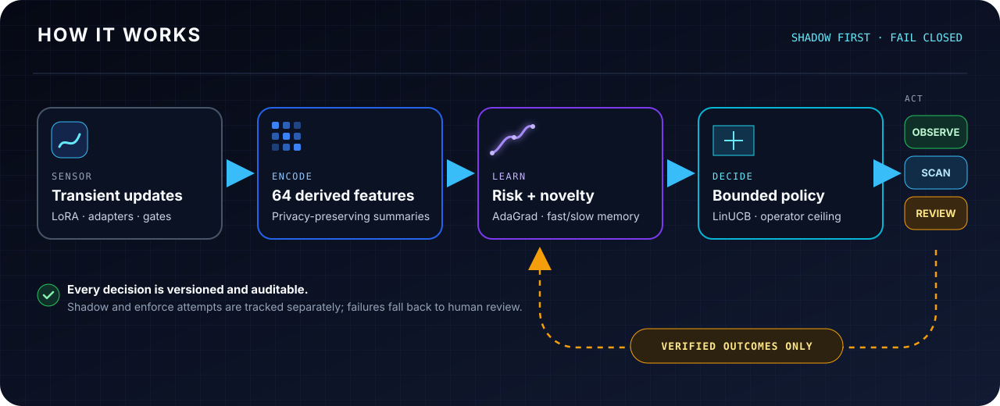

<p align="center">
  
</p>

<h1 align="center">Weight-Space Observatory</h1>

<p align="center"><strong>The firewall for AI systems that think in weights.</strong></p>

<p align="center">
  <a href="https://github.com/paulchum/weight-space-observatory/actions/workflows/python-app.yml"></a>
  <a href="https://www.python.org/"></a>
  <a href="LICENSE"></a>
  <a href="https://github.com/paulchum/weight-space-observatory/stargazers"></a>
</p>

<p align="center">
  <a href="#quickstart">Run the demo</a> ·
  <a href="#how-it-works">See the architecture</a> ·
  <a href="docs/autonomous_brain_2026.md">Read the research decision</a> ·
  <a href="CONTRIBUTING.md">Contribute</a>
</p>

> **Prompts are no longer the whole attack surface.** Emerging agent systems can pass
> information through transient LoRA updates, adapters, routing gates, and hidden
> weight-space state. Weight-Space Observatory makes that invisible layer measurable—and
> adds a bounded learned control plane that can observe, scan, or escalate it.

## Meet `wso-brain`

The **Autonomous Adapter Trust Gateway** is a local, persistent
observe → decide → act → learn loop for derived weight-space telemetry.

- **Learns risk:** an online AdaGrad logistic model plus fast/slow novelty memory.
- **Chooses bounded responses:** LinUCB operates inside an immutable operator-owned
  action ceiling.
- **Improves from outcomes:** verified feedback updates risk, policy, and compact
  strategy memory.
- **Hardens itself safely:** sealed feature-space self-play uses frozen holdouts,
  duplicate screening, and exact confidence-bound promotion gates.
- **Leaves an audit trail:** versioned state, per-decision ledgers, exactly-once local
  action attempts, and fail-closed receipts.
- **Starts in shadow mode:** recommendations are recorded without invoking an executor.

This is autonomy with a leash: the model can learn *within* the envelope, but it cannot
rewrite the envelope.

## How it works

<p align="center">
  
</p>

The default local executor is deliberately read-only. It supports observation, a
registered derived spectral scan, and human-review escalation. Quarantine exists in the
policy vocabulary but is outside the default autonomous ceiling.

## Quickstart

```bash
git clone https://github.com/paulchum/weight-space-observatory.git
cd weight-space-observatory
python3 -m venv .venv
source .venv/bin/activate
python -m pip install -e .

wso-brain demo --out-dir artifacts/brain_demo
wso-brain status --state-dir artifacts/brain_demo/brain
```

The deterministic demo runs the complete local loop: trusted bootstrap, shadow
decisions, verified incident feedback, policy learning, and sealed self-play. It writes
human-readable decisions plus machine-readable state and ledgers under
`artifacts/brain_demo/`.

### Honest demo result

The checked-in synthetic fixture currently produces:

| Metric | Result |
|---|---:|
| AUROC | 0.864 |
| Precision | 0.758 |
| Recall | 0.781 |
| Unsafe self-play promotion | Rejected |

These numbers prove deterministic mechanics and gate execution—not deployed-system
detection. Real performance requires frozen, representative telemetry from the target
runtime.

## Why this became possible now

The individual ingredients are not new. The product opportunity is.

| Date | What changed | Why it matters here |
|---|---|---|
| Sep 2025 | [ReasoningBank](https://arxiv.org/abs/2509.25140) showed agents learning compact lessons from successful and failed trajectories. | Learn from verified outcomes without replaying raw traces. |
| Feb 2026 | [Weight-space LoRA backdoor detection](https://arxiv.org/abs/2602.15195) reported strong controlled-benchmark results from derived spectral features. | Weight geometry became a credible learned sensor surface. |
| May 2026 | [TFlow](https://arxiv.org/abs/2605.13839) introduced query-specific inter-agent communication through transient LoRA perturbations. | A new below-prompt communication surface needs an independent monitor. |
| Jun 2026 | DeepMind published an [AI Control Roadmap](https://deepmind.google/blog/securing-the-future-of-ai-agents/). | Learned monitors still need immutable capability ceilings. |
| Jul 2026 | OpenAI described automated defensive hardening with [GPT-Red](https://openai.com/index/unlocking-self-improvement-gpt-red/). | Sealed hard-example generation became a practical control primitive. |

The full dated thesis, commercial wedge, contracts, and production proof requirements
are in the [August 1, 2026 research and build decision](docs/autonomous_brain_2026.md).

## CLI

```text
wso-brain bootstrap          initialize from trusted baseline and labeled outcomes
wso-brain decide             score telemetry and choose a bounded response
wso-brain feedback           learn from a verified realized outcome
wso-brain status             inspect readiness, versions, and learning state
wso-brain reconcile-action   resolve an orphaned local action intent
wso-brain self-play          run sealed feature-space defensive hardening
wso-brain demo               run the deterministic end-to-end fixture
```

The original observability toolkit remains available as `wso-audit` for telemetry
collection, task-conditioned baselines, analysis, OTEL-friendly export, and reports.

## TFlow integration

`OfficialTFlowAdapter.solve(..., brain=brain)` captures derived telemetry from a real
transient inference and scores it after generation returns. Capture is serialized with
a process-global reentrant lock and restores the upstream hook during cleanup.

**Important:** this is a post-generation monitor, not a blocker for the current
response. Production pre-response control needs an upstream request-scoped capture
hook rather than temporary module monkey-patching.

## Trust boundaries

<details>
<summary><strong>What the project refuses to pretend</strong></summary>

- Synthetic fixtures are not deployment evidence.
- A provenance boolean is an out-of-band caller attestation, not cryptographic proof.
- Local file permissions are not encryption or distributed consensus.
- Duplicate screening reduces obvious evaluation contamination; it cannot prove i.i.d.
  sampling or dataset authenticity.
- Executor validation happens after the executor returns and cannot undo an
  unauthorized external side effect.
- The default action ceiling is `deep_scan`; external quarantine requires an explicit
  operator decision and capability-scoped executor.

The detailed schema 2.1 invariants, resource caps, locking model, promotion math, and
failure behavior are documented in
[the research decision](docs/autonomous_brain_2026.md).

</details>

## Project status

| Surface | Status |
|---|---|
| Local learned trust gateway | Working prototype |
| Shadow and enforce separation | Implemented |
| Exactly-once local action-attempt journal | Implemented |
| Sealed self-play promotion gates | Implemented |
| Official TFlow-derived telemetry bridge | Post-generation integration |
| Production pre-response blocking | Not yet implemented |
| Independent real-deployment validation | Required |

## Contributing

The highest-value contributions are real-runtime collectors, reproducible frozen
evaluation packs, executor adapters with narrow capabilities, calibration work, and
clear failure-case reports. Start with [CONTRIBUTING.md](CONTRIBUTING.md) and the
[responsible-research boundary](SECURITY.md).

If this is a problem you want solved, **star the repository and bring one real adapter
runtime we can measure honestly.**

## License

[MIT](LICENSE) © 2026 Paul C.
